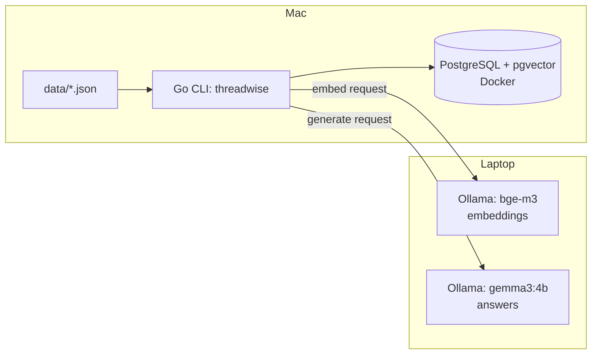

# Architecture

threadwise is a Go CLI that indexes chat messages into pgvector and answers questions via retrieval-augmented generation using a remote Ollama instance.



## Flows

1. **Indexing**: load `data/messages.json` → embed each message via Ollama (`bge-m3`) → store message + embedding in pgvector.
2. **Query**: question → embed via Ollama (`bge-m3`) → vector similarity search → top-5 messages → send question + context to Ollama (`gemma3:4b`) → answer with citations to the top-5 messages.

## Planned folder layout

```
cmd/threadwise/      # planned
internal/
  config/            # planned
  store/             # planned
  ollama/            # planned
  search/            # planned
  eval/
  rag/               # planned
```

## Decisions

| Decision | Alternative considered | Why |
|---|---|---|
| pgvector in existing Postgres | Separate vector DB (Qdrant, Pinecone) | One less moving part for a small project |
| Plain SQL | ORM | Simpler, no abstraction overhead for a handful of queries |
| Migrations applied via `psql` | Migration framework | No extra dependency needed yet |
| CLI | HTTP API | Fits a local/offline eval + query workflow, no server needed |
| IDs taken from source JSON | Generated IDs (UUID/serial) | Keeps traceability back to the synthetic dataset |
| Config via `.env` | Config file / flags framework | Matches existing `OLLAMA_URL` convention, avoids new deps |
