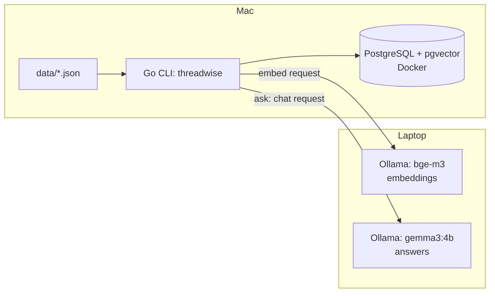

# Architecture

threadwise is a Go CLI that indexes chat messages into pgvector and answers questions via retrieval-augmented generation using a remote Ollama instance.



## Flows

1. **Indexing**: load `data/messages.json` → embed each message via Ollama (`bge-m3`) → store message + embedding in pgvector.
2. **Query**: question → embed via Ollama (`bge-m3`) → vector similarity search → top-k messages → send question + context to Ollama (`gemma3:4b`) → answer with citations to the top-k messages. This is the `ask` command; it prints only the cited messages as sources and warns about citations of messages that were not found.
3. **Retrieval without Ollama**: with `-method fts` the question is turned into an OR query over the `tsv` column (PostgreSQL full-text search, Russian configuration) and ranked by `ts_rank`; only `ask` still needs the chat model.
4. **Evaluation**: the `eval` command runs the labelled questions from `data/questions.json` through both retrievers and reports hit@k and MRR@k with the list of misses.

## Folder layout

```
cmd/threadwise/
internal/
  config/
  store/
  ollama/
  search/
  eval/
  rag/
```

## Decisions

| Decision | Alternative considered | Why |
|---|---|---|
| pgvector in existing Postgres | Separate vector DB (Qdrant, Pinecone) | One less moving part for a small project |
| Plain SQL | ORM | Simpler, no abstraction overhead for a handful of queries |
| Migrations applied via `psql` | Migration framework | No extra dependency needed yet |
| CLI | HTTP API | Fits a local/offline eval + query workflow, no server needed |
| IDs taken from source JSON | Generated IDs (UUID/serial) | Keeps traceability back to the synthetic dataset |
| Config via `.env` | Config file / flags framework | Matches existing `OLLAMA_URL` convention, avoids new deps |
| Two retrievers (fts and vector) behind one `Retriever` interface | One retriever with a flag-less code path | Lets `eval` and `ask` work with any method and makes the comparison fair |
| hit@k and MRR on a labelled question set | Manual spot checks | Gives a repeatable number instead of an impression |
